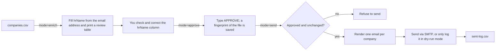

# Job Mailer


A command-line tool, built with Java and Spring Boot, that sends personalised job-application emails with your resume attached. It is designed for small, careful batches: every send goes through a **dry run**, a **human review of the recipient greetings**, and an **approval step that is tied to the exact contents of your company list**.

> **Intended use:** personal job applications to companies that publish an address for applicants. It is not a bulk-marketing tool. See [Responsible use](#responsible-use).

---

## Table of contents

- [Features](#features)
- [How it works](#how-it-works)
- [Tech stack](#tech-stack)
- [Prerequisites](#prerequisites)
- [Getting started](#getting-started)
- [Usage](#usage)
- [Company list format](#company-list-format)
- [Email template](#email-template)
- [Configuration reference](#configuration-reference)
- [Safeguards](#safeguards)
- [Project structure](#project-structure)
- [Design notes](#design-notes)
- [Testing](#testing)
- [Troubleshooting](#troubleshooting)
- [Responsible use](#responsible-use)
- [Roadmap](#roadmap)
- [License](#license)
- [Author](#author)

---

## Features

- **Personalised emails from a CSV**: company name and recipient greeting are filled into a text template, one email per company.
- **Greeting derived from the email address**: `priya.sharma@acme.com` becomes `Dear Priya,`; role addresses such as `careers@acme.com` become `Dear Sir/Ma'am,`. The rule is deliberately conservative, because a wrong name is worse than a neutral greeting.
- **Human-in-the-loop approval**: generating greetings and sending are separate commands. Sending refuses to run unless a person has reviewed and approved the CSV, and any later edit to the file invalidates the approval.
- **Dry run by default**: nothing is delivered until you explicitly switch it off.
- **Duplicate protection and rate limiting**: a persistent sent-log prevents emailing the same address twice, and a daily limit plus a delay between messages keep the sending pattern gentle.
- **Fails early and loudly**: invalid settings, a missing resume, an unknown template placeholder or unfinished template text stop the run *before* any email is sent.
- **Secrets stay out of Git by default**: credentials and personal details come from environment variables; the `data/` folder and local override files are git-ignored.

## How it works



The application has three modes, selected with `--jobmailer.mode=<mode>`. With no mode set, it starts and exits without doing anything.

| Mode | What it does | Sends email? |
|---|---|---|
| `enrich` | Fills the `hrName` column from each email address, keeps a `.bak` backup, prints a review table, and cancels any earlier approval | No |
| `approve` | Shows the table again and asks you to type `APPROVE`; stores a SHA-256 fingerprint of the CSV | No |
| `send` | Checks the approval, renders all emails, then sends them (or previews them in dry-run mode) | Yes, unless dry-run |

## Tech stack

| Area | Technology |
|---|---|
| Language | Java 21 |
| Framework | Spring Boot (no web server; runs as a command-line application) |
| Email | Spring `JavaMailSender` over SMTP (Gmail by default) |
| CSV | OpenCSV |
| Build | Maven (wrapper included) |
| Testing | JUnit 5, Mockito, AssertJ |

## Prerequisites

- **JDK 21** (`java -version` should report 21)
- **Git**
- A **Gmail account with 2-Step Verification** and an **App Password** (see [Create a Gmail App Password](#2-create-a-gmail-app-password)). Other SMTP providers also work by changing the `spring.mail.*` properties.
- Maven is optional, because the project ships with the Maven wrapper (`mvnw`).

## Getting started

### 1. Clone and build

```bash
git clone https://github.com/pvchate/job-mailer.git
cd job-mailer
./mvnw clean verify        # Windows: mvnw.cmd clean verify
```

### 2. Create a Gmail App Password

1. Open your Google Account, then **Security**, and turn on **2-Step Verification**.
2. Search for **App passwords** and create one named `job-mailer`.
3. Copy the 16-character password. It is shown only once. Use it **without spaces**.

Never use your normal Gmail password, and never commit the App Password to Git.

### 3. Set environment variables

The application reads its secrets and personal details from the environment.

| Variable | Meaning |
|---|---|
| `MAIL_USERNAME` | Your full Gmail address |
| `MAIL_PASSWORD` | The 16-character App Password |
| `SENDER_CONTACT` | Phone number shown in the email signature |
| `SENDER_LINKEDIN` | LinkedIn URL shown in the email signature |

A template with fake values is provided in [`.env.example`](.env.example).

**Windows (PowerShell), for the current terminal session:**
```powershell
$env:MAIL_USERNAME="you@gmail.com"
$env:MAIL_PASSWORD="your16charapppassword"
$env:SENDER_CONTACT="+91 90000 00000"
$env:SENDER_LINKEDIN="https://www.linkedin.com/in/your-profile"
```

**macOS / Linux:**
```bash
export MAIL_USERNAME="you@gmail.com"
export MAIL_PASSWORD="your16charapppassword"
export SENDER_CONTACT="+91 90000 00000"
export SENDER_LINKEDIN="https://www.linkedin.com/in/your-profile"
```

In IntelliJ IDEA, add the same variables under **Run, Edit Configurations, Environment variables**, and do **not** tick *Store as project file*.

#### Alternative: put the values in a properties file

You can also write the values directly into `src/main/resources/application.properties` for a quick local trial:

```properties
spring.mail.username=you@gmail.com
spring.mail.password=your16charapppassword
jobmailer.sender-email=you@gmail.com
jobmailer.sender-contact=+91 90000 00000
jobmailer.sender-linked-in=https://www.linkedin.com/in/your-profile
```

> **This is not the safe option.** `application.properties` is tracked by Git, so anyone who can read the file can read your credentials, and committing or pushing it would publish them. If you use this approach, never commit or push the edited file.

A safer middle ground is a personal override file that Git ignores. Create `application-local.properties` in the project root (it is listed in `.gitignore`), put the same lines in it, and start the application with `--spring.profiles.active=local`. The values in it take precedence over `application.properties`.

### 4. Prepare your data

The `data/` folder holds private files and is git-ignored.

```bash
mkdir data
cp samples/companies.sample.csv data/companies.csv    # Windows: copy samples\companies.sample.csv data\companies.csv
```

1. Put your resume PDF in `data/`. It is attached under its own file name, so name it professionally, for example `Firstname_Lastname_Java_Developer.pdf`.
2. Point the application at it in `src/main/resources/application.properties`:
   ```properties
   jobmailer.resume-path=data/Firstname_Lastname_Java_Developer.pdf
   jobmailer.sender-name=Firstname Lastname
   ```
3. Replace the sample rows in `data/companies.csv` with your own companies. See [Company list format](#company-list-format).

### 5. Write your email

Edit [`src/main/resources/templates/application-email.txt`](src/main/resources/templates/application-email.txt) and replace the wording and highlights with your own. Any text left in `[square brackets]` makes the application refuse to send. See [Email template](#email-template).

## Usage

Run the commands in order. Each one is a separate run of the application.

**With Maven** (macOS / Linux shown; in PowerShell use `.\mvnw.cmd` and put the whole `-D...` argument in quotes):

```bash
# 1. Fill the greetings and review them
./mvnw spring-boot:run -Dspring-boot.run.arguments="--jobmailer.mode=enrich"

# 2. Open data/companies.csv, correct any wrong hrName, save. Then approve:
./mvnw spring-boot:run -Dspring-boot.run.arguments="--jobmailer.mode=approve"

# 3. Dry run: prints every email in full, sends nothing
./mvnw spring-boot:run -Dspring-boot.run.arguments="--jobmailer.mode=send"

# 4. Real send: asks you to type SEND first
./mvnw spring-boot:run -Dspring-boot.run.arguments="--jobmailer.mode=send --jobmailer.dry-run=false"
```

**With an IDE:** run `JobMailerApplication` and put the arguments, for example `--jobmailer.mode=enrich`, in **Program arguments**. This is the easiest way to answer the interactive prompts.

**As a jar:**
```bash
./mvnw clean package
java -jar target/job-mailer-<version>.jar --jobmailer.mode=send
```

The `approve` and real `send` commands ask for confirmation in the console, so run them in an interactive terminal.

### Example: the review table (`enrich`)

```
#  | Company              | Email                    | hrName    | Check
-------------------------------------------------------------------------
1  | Example Tech Pvt Ltd | priya.sharma@example.com | Priya     | check name
2  | Sample Systems       | careers@example.org      | Sir/Ma'am | generic

2 rows: 1 with a name to check, 1 generic, 0 missing
```

Rows labelled **check name** are the ones where a first name was guessed from the address. Verify those before approving.

### Sending in batches

The daily limit is counted from `data/sent-log.csv`, so a list larger than the limit is sent over several days. Run `send` again the next day and only the remaining companies are processed. After a real batch, check your inbox for bounce messages (*Delivery Status Notification*) before sending the next one. The application does not read bounces itself.

## Company list format

A comma-separated, UTF-8 file with a header row. Column order does not matter and names are not case-sensitive.

| Column | Required | Description |
|---|---|---|
| `company` | Yes | Company name, used in the subject and body |
| `email` | Yes | Recipient address |
| `hrName` | No | Filled by `enrich`; a name you type yourself is never overwritten |
| `city`, `role`, `note` | No | Reserved for future template use |

```csv
company,email,hrName,city,role,note
Example Tech Pvt Ltd,hr@example.com,Sir/Ma'am,Pune,Java Developer,
"Demo Solutions, Pune",careers@example.net,Sir/Ma'am,Pune,Java Developer,
```

Rows with a missing company name, an invalid email address or a duplicate address are skipped with a warning that includes the line number. A missing file, an empty file or a missing `company` / `email` column stops the run.

## Email template

The template is a plain text file. The **first line is the subject**, followed by a blank line and the body.

```text
Subject: Java Developer (4 Years) – Application for {{company}}

Dear {{hrName}},

I am writing to apply for Java Developer opportunities at {{company}}. ...

Warm regards,
{{senderName}}
Phone: {{senderContact}}
Email: {{senderEmail}}
LinkedIn: {{senderLinkedIn}}
```

Available blanks:

| Blank | Value |
|---|---|
| `{{company}}` | `company` column |
| `{{hrName}}` | `hrName` column, or `Sir/Ma'am` if empty |
| `{{senderName}}` | `jobmailer.sender-name` |
| `{{senderEmail}}` | `jobmailer.sender-email` |
| `{{senderContact}}` | `jobmailer.sender-contact` |
| `{{senderLinkedIn}}` | `jobmailer.sender-linked-in` |

An unknown blank (for example a typo such as `{{compnay}}`) or any leftover `[square bracket]` text stops the run before the first email is sent.

## Configuration reference

Settings live in `src/main/resources/application.properties` and can be overridden on the command line (`--jobmailer.daily-limit=10`) or through environment variables.

| Property | Default | Description |
|---|---|---|
| `jobmailer.mode` | *(not set)* | `enrich`, `approve` or `send`. If unset, the application does nothing |
| `jobmailer.sender-name` | *(set to your name)* | Name shown as the sender and in the signature |
| `jobmailer.sender-email` | `${MAIL_USERNAME}` | The From address |
| `jobmailer.sender-contact` | `${SENDER_CONTACT}` | Phone number for the signature |
| `jobmailer.sender-linked-in` | `${SENDER_LINKEDIN}` | LinkedIn URL for the signature |
| `jobmailer.resume-path` | *(set to your resume)* | Resume PDF to attach; the file name is shown to recipients |
| `jobmailer.companies-path` | `data/companies.csv` | Input list |
| `jobmailer.sent-log-path` | `data/sent-log.csv` | Record of sent and failed emails |
| `jobmailer.daily-limit` | `25` | Maximum real emails per calendar day (1 to 200), counted across runs in the computer's time zone |
| `jobmailer.delay-seconds` | `45` | Pause between real emails (minimum 10) |
| `jobmailer.dry-run` | `true` | When `true`, emails are only printed to the log |
| `spring.mail.*` | Gmail SMTP | Host, port and credentials; change these to use another provider |

Invalid values, such as a daily limit of 0 or an invalid sender address, stop the application at startup with a clear message.

## Safeguards

| Risk | Safeguard |
|---|---|
| Sending by accident | Dry run is the default, and a real send needs the word `SEND` typed in the console |
| Wrong greeting names | `enrich` and `send` are separate commands; `send` refuses to run until a person types `APPROVE` after reviewing the table |
| Editing the list after review | The approval stores a SHA-256 fingerprint of the file, so any change invalidates it |
| Template mistakes | The whole campaign is rendered up front; unknown blanks and unfinished `[brackets]` abort before anything is sent |
| Duplicate applications | Successful sends are written to the sent-log and skipped on later runs; failed addresses are retried |
| Sending too fast | Daily limit and a delay between emails |
| A wrong password or blocked account | The campaign stops after 3 consecutive failures |
| Losing your list | `enrich` writes a `.bak` copy and replaces the file atomically through a temporary file |
| Leaking secrets | By default, credentials and personal details come from environment variables, and `data/`, `.env` and `application-local.properties` are git-ignored |

## Project structure

```text
job-mailer/
├── samples/
│   └── companies.sample.csv          Example input with fake companies
├── src/
│   ├── main/
│   │   ├── java/com/jobmailer/job_mailer/
│   │   │   ├── config/               MailerProperties (typed, validated settings)
│   │   │   ├── model/                Company, EmailMessage
│   │   │   ├── repository/           SentLogRepository
│   │   │   ├── service/              CompanyCsvReader, CompanyCsvEnricher, HrNameResolver,
│   │   │   │                         CsvApprovalService, ReviewTableFormatter,
│   │   │   │                         EmailTemplateRenderer, EmailSender (SMTP and dry-run),
│   │   │   │                         CampaignService
│   │   │   ├── runner/               EnrichRunner, ApproveRunner, SendRunner, ConsolePrompt
│   │   │   └── exception/            Domain exceptions
│   │   └── resources/
│   │       ├── application.properties
│   │       └── templates/application-email.txt
│   └── test/java/...                 Unit tests
├── .env.example                      Environment variables with fake values
├── pom.xml
└── README.md
```

## Design notes

- **One interface, two senders.** `EmailSender` has an SMTP implementation and a logging implementation. Exactly one is created, chosen by `jobmailer.dry-run`, so the rest of the code never needs to know which mode it is in.
- **Typed, validated configuration.** `MailerProperties` is an immutable record with Bean Validation constraints, so a bad setting fails at startup and not halfway through a batch.
- **Approval bound to content.** The approval is a hash of the file, not a flag, so it cannot go stale silently.
- **Commands as runners.** Each mode is an `ApplicationRunner` activated by `@ConditionalOnProperty`, which keeps the three workflows separate and impossible to trigger together.
- **Unchecked, specific exceptions** (`EmailDeliveryException`, `CompanyDataException`, `EmailTemplateException`, `ApprovalRequiredException`) carry their cause, so the logs show both what failed and why.
- **Constructor injection and small classes**, with Javadoc on every class and method.

## Testing

```bash
./mvnw test
```

The unit tests use JUnit 5, Mockito and AssertJ. File-based tests write to a temporary directory (`@TempDir`) and never touch real data, and no test needs network access or SMTP credentials. They cover the SMTP sender, CSV reader and enricher, greeting resolver, template renderer, approval service, review table and console prompt.

## Troubleshooting

| Symptom | Cause and fix |
|---|---|
| `535 5.7.8 Username and Password not accepted` | Wrong or space-containing App Password, or the App Password belongs to a different account than `MAIL_USERNAME` |
| App fails at startup with `Binding to target ... MailerProperties failed` | A required setting or environment variable is missing; the message names the property |
| `Required column missing in CSV header` | The file is not comma-separated, or lacks a `company` or `email` column |
| `has not been approved, or was changed after approval` | Run `--jobmailer.mode=approve` again after any edit to the CSV |
| `The template still contains unfinished text [...]` | Replace every `[bracketed]` example in the template with your own details |
| `Unknown blank {{...}} in the template` | A placeholder is misspelled; use one from the table in [Email template](#email-template) |
| `Nothing to send` | Every address is already in the sent-log, or today's daily limit is used up |
| The application starts and exits without any output | `jobmailer.mode` is missing or misspelled; it must be `enrich`, `approve` or `send` |

## Responsible use

- Write only to addresses that organisations publish for applicants, such as a careers page or a job posting. Do not guess addresses, scrape websites or social networks, or use personal addresses of individual recruiters.
- Keep batches small and check for bounces; a high bounce rate damages your sender reputation.
- Respect any request to stop contacting an address, and follow the anti-spam and data-protection laws that apply to you and to your recipients.
- Gmail enforces its own sending limits; this tool's limits are conservative defaults, not a guarantee against account restrictions.

## Roadmap

- Unit tests for the campaign service, sent-log repository and the three runners
- Several template variants, chosen deterministically per company, to reduce identical-message patterns
- Optional CI pipeline (GitHub Actions) running the tests on every push
- Optional AI-assisted opening paragraph behind the same message-composer interface

## License

Released under the MIT License. See [LICENSE](LICENSE).

## Author

**Pandurang Vishnu Chate**, Java developer (Spring Boot)
GitHub: [@pvchate](https://github.com/pvchate) · LinkedIn: [pandurang-chate](https://linkedin.com/in/pandurang-chate-155596189)
